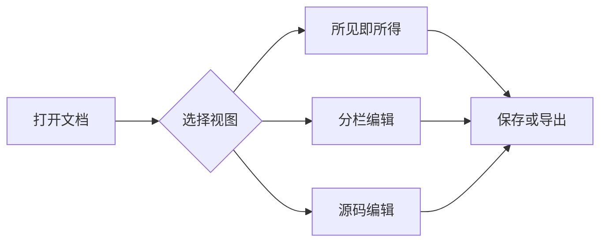
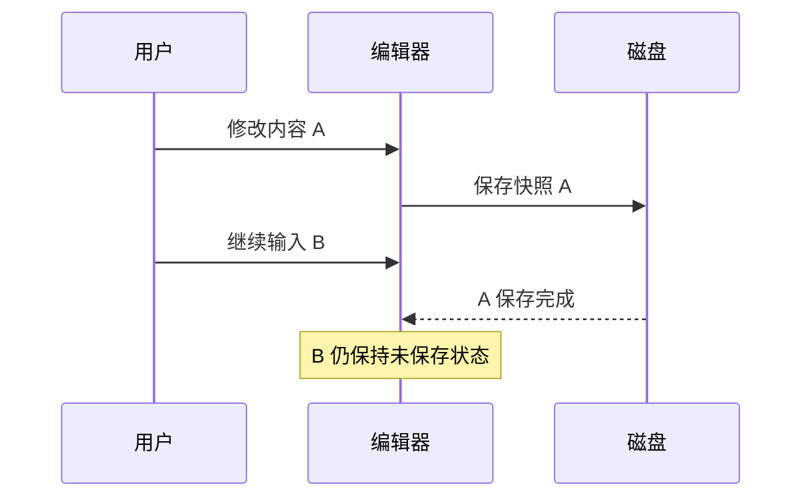
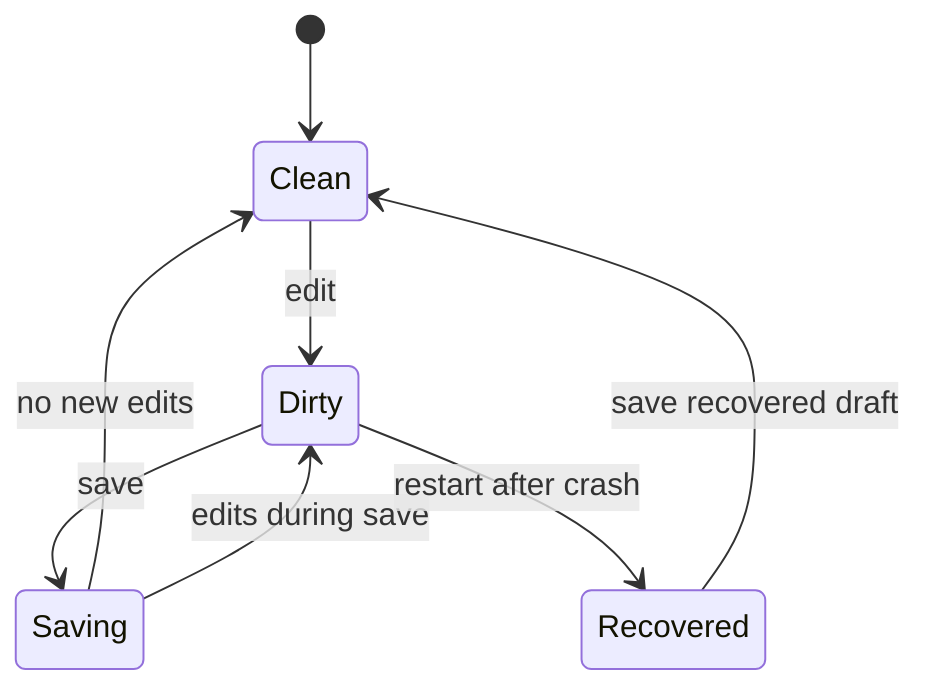
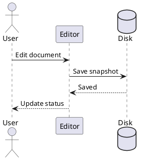

# Inkdown 综合测试文档

这份文档用于测试 **Inkdown 0.7.0** 的常用 Markdown 内容和编辑交互。

建议先“另存为”一份测试副本，再尝试修改、撤销、表格操作和保存。

> **测试说明**
>
> - 分别检查所见即所得、分栏预览、纯源码三种视图。
> - 分栏左侧应显示 Mermaid、PlantUML、Vega 等图表，与所见即所得的阅读效果保持一致；点击内容块或图表可定位右侧源码。
> - PlantUML 使用设置中的服务器，需要网络；其他图表示例不引用外部数据。
> - 部分扩展语法受偏好设置控制，见对应小节说明。

## 目录

- [文本与行内格式](#文本与行内格式)
- [标题层级](#标题层级)
- [列表与任务](#列表与任务)
- [引用与提示块](#引用与提示块)
- [表格](#表格)
- [代码块](#代码块)
- [数学公式](#数学公式)
- [链接与本地图片](#链接与本地图片)
- [HTML 与折叠内容](#html-与折叠内容)
- [图表](#图表)
- [脚注与参考链接](#脚注与参考链接)
- [光标与滚动定位](#cursor-mapping)
- [查找替换样本](#查找替换样本)
- [手动回归清单](#手动回归清单)

## 文本与行内格式

这是一段普通中文正文，用于检查字号、字重、行高和段落间距。Mixed English text、数字 0123456789、中文标点「括号」以及 emoji 😀 🚀 ✅ 都应正常显示。

**加粗文字**，*斜体文字*，***粗斜体文字***，~~删除线文字~~，`行内代码`，==高亮文字==。

HTML 行内格式：<u>下划线</u>、<sup>上标</sup>、<sub>下标</sub>、<kbd>Ctrl</kbd> + <kbd>S</kbd>。

扩展上下标：H~2~O、x^2^。若显示原始符号，可在偏好设置中启用上下标扩展。

行内公式：$E = mc^2$；电机机械角速度：$\omega_m = \frac{2\pi n}{60}$。

行内差异：原句中包含 {+新增内容+} 和 {-删除内容-}，检查浅色、暗黑和夜间主题下的可读性。

转义字符：\*这不是斜体\*，\#这不是标题，\[这不是链接\]，\`这不是代码\`。

实体字符：&amp;、&lt;、&gt;、&copy;、&nbsp;、&#9733;。

这一行末尾有两个空格，用于测试硬换行。  
这一行应位于同一段落的下一行。

这一行与下一行之间只有一个源码换行。
请观察“软换行”选项对显示效果的影响。

---

## 标题层级

### 三级标题

三级标题下的正文。

#### 四级标题

四级标题下的正文。

##### 五级标题

五级标题下的正文。

###### 六级标题

六级标题下的正文。

Setext 二级标题
--------------

这是使用下划线形式书写的二级标题，检查大纲和导出中的层级。

## 列表与任务

### 无序与嵌套列表

- 一级项目 A
  - 二级项目 A.1
    - 三级项目 A.1.1
    - 三级项目 A.1.2，包含 **加粗** 和 `代码`
  - 二级项目 A.2
- 一级项目 B
- 一级项目 C

### 有序与混合列表

1. 打开测试文档。
2. 切换编辑视图。
   - 观察预览。
   - 尝试格式命令。
3. 保存测试副本。
4. 导出 HTML、PDF 和 Word。

从非 1 数字开始的列表：

7. 第七项。
8. 第八项。
9. 第九项。

### 包含多个段落的列表

- 项目一的第一段。

  项目一的第二段，检查缩进与段间距。

- 项目二。

### 任务列表

- [x] 打开文档。
- [x] 确认中文与英文显示正常。
- [ ] 点击这个复选框，观察是否能切换状态。
- [ ] 在源码中修改任务状态，再切回所见即所得。
- [ ] 撤销一次任务修改，再重做。
  - [ ] 嵌套待办事项。
  - [x] 嵌套已完成事项。

## 引用与提示块

> 第一层引用。
>
> 引用中的第二段，含 **加粗文字**。
>
> > 第二层引用。
> >
> > - 引用中的列表项。
> > - 另一项。

> [!NOTE]
> 普通提示：检查提示块图标、边框和正文颜色。

> [!TIP]
> 实用建议：可以用圆盘快速插入表格、代码块和折叠块。

> [!IMPORTANT]
> 重要事项：在暗黑主题下也应保持足够对比度。

> [!WARNING]
> 警告样例：这里只是显示测试，不代表应用发生错误。

> [!CAUTION]
> 注意样例：测试删除操作前，请先保存副本。

## 表格

### 对齐与行内格式

| 名称   | 数值（右对齐） | 状态（居中） | 说明                |
|:------ | --------------:|:------------:|:------------------- |
| 电压   | 24.00          | 正常         | 包含 **加粗**       |
| 电流   | 3.50           | 待检查       | 包含 `inline code`  |
| 转速   | 1500           | 运行中       | 行内公式 $n = 1500$ |
| 温度   | 42.8           | 正常         | ~~旧值~~ → 新值     |
| 管道符 | 1              | 正常         | 转义的竖线：a\|b    |
| 空值   |                |              | 保留空单元格        |

### 表格操作样例

| A 列 | B 列 | C 列 |
| ---- | ---- | ---- |
| A1   | B1   | C1   |
| A2   | B2   | C2   |
| A3   | B3   | C3   |
| A4   | B4   | C4   |

建议在这张表上测试：连续插入行、删除行、插入列、改变对齐、拖动行列、撤销和重做。切换暗黑主题后检查表格浮动菜单。

### 宽表与长单元格

| 参数     | 最小值 | 典型值 | 最大值 | 单位 | 分类 | 长内容                                                       |
| -------- | ------:| ------:| ------:| ---- | ---- | ------------------------------------------------------------ |
| 输入电压 | 12     | 24     | 48     | V    | 电源 | 中文长单元格，用于检查自动换行、表格横向滚动和导出分页效果。 |
| 测试路径 | 0      | 1      | 2      | —    | 文件 | `Tests_App/host_tools/example_markdown_table_long_name.py`   |

## 代码块

### C 语言

```c
#include <stdint.h>

typedef struct {
    float target_rpm;
    float measured_rpm;
    uint8_t enabled;
} MotorState;

float calculate_error(const MotorState *state)
{
    return state->target_rpm - state->measured_rpm;
}
```

### TypeScript

```typescript
interface TestDocument {
  title: string
  content: string
  savedContent: string
}

function isDirty(document: TestDocument): boolean {
  return document.content !== document.savedContent
}

const message = '中文字符串与 English text'
console.log(message)
```

### Python

```python
import math

def rpm_to_rad_s(rpm: float) -> float:
    return rpm * 2.0 * math.pi / 60.0

for speed in [0, 500, 1000, 1500]:
    print(f"{speed:4d} RPM -> {rpm_to_rad_s(speed):.2f} rad/s")
```

### JSON 与命令行

```json
{
  "name": "Inkdown",
  "version": "0.7.0",
  "features": ["源码", "分栏预览", "草稿恢复"],
  "enabled": true
}
```

```powershell
# 这是显示用的命令样例，不会自动执行。
Get-ChildItem -File | Select-Object Name, Length
```

### 围栏嵌套

下面使用四个反引号包住包含三反引号的内容。内部代码不应提前结束外层代码块。

````markdown
# 这行是代码块内容，不是文档标题

```javascript
console.log('nested fence')
```

末尾仍位于同一个外层代码块中。
````

### 波浪号围栏

~~~text
第一行。

第三行，中间保留空行。
特殊字符：<tag> & "quotes" 'single quotes' \\path\\file
~~~

## 数学公式

### 独立公式

$$
E = mc^2
$$

### 分式、根号与求和

$$
x = \frac{-b \pm \sqrt{b^2 - 4ac}}{2a},
\qquad
S = \sum_{k=1}^{n} k = \frac{n(n+1)}{2}
$$

### 多行对齐

$$
\begin{aligned}
u_d &= R i_d + L_d \frac{di_d}{dt} - \omega_e L_q i_q \\
u_q &= R i_q + L_q \frac{di_q}{dt} + \omega_e(L_d i_d + \psi_f)
\end{aligned}
$$

### 矩阵

$$
\begin{bmatrix}
i_d \\
i_q
\end{bmatrix}
=
\begin{bmatrix}
\cos\theta & \sin\theta \\
-\sin\theta & \cos\theta
\end{bmatrix}
\begin{bmatrix}
i_\alpha \\
i_\beta
\end{bmatrix}
$$

### 分段函数

$$
f(x) = \begin{cases}
0, & x < 0 \\
x^2, & x \ge 0
\end{cases}
$$

## 链接与本地图片

[项目主页](https://github.com/IoT-Joker/inkdown)，[参考式链接][inkdown-home]，以及 [跳转到定位测试](#cursor-mapping)。

以下图片引用项目自带的图标，**不需要联网**。切换主题和视图后检查是否正常显示。


同一张图片使用 HTML 设置尺寸：


文件路径显示样例：`E:\Desktop\JX\07-DSH\02-typra2\examples\comprehensive-test.md`。

## HTML 与折叠内容

<details>
<summary>点击展开：隐藏内容测试</summary>

这里包含 **加粗**、`代码` 和一个列表：

- 折叠内容第一项。
- 折叠内容第二项。

</details>

<div>
这是一段 HTML 区块，检查编辑、预览和导出中的显示。
</div>

<!-- 这是一条 HTML 注释。源码中可见，渲染结果中通常不显示。 -->

分隔线样例：

***

## 图表

本节的图表用于检查对应渲染器。所见即所得和分栏左侧均应显示图表；PlantUML 需要网络或可用的自建服务器。

### Mermaid 流程图



### Mermaid 时序图



### Mermaid 状态图



### PlantUML



### Vega-Lite 柱状图

```vega-lite
{
  "$schema": "https://vega.github.io/schema/vega-lite/v5.json",
  "description": "内嵌测试数据，不下载外部数据集。",
  "width": 360,
  "height": 180,
  "data": {
    "values": [
      {"category": "A", "value": 28},
      {"category": "B", "value": 55},
      {"category": "C", "value": 43},
      {"category": "D", "value": 72}
    ]
  },
  "mark": "bar",
  "encoding": {
    "x": {"field": "category", "type": "nominal"},
    "y": {"field": "value", "type": "quantitative"},
    "color": {"field": "category", "type": "nominal"}
  }
}
```

## 脚注与参考链接

这是第一个脚注引用[^first]。这里再次引用同一个脚注[^first]，并添加第二个脚注[^second]。

参考链接既可以放在正文中：[Inkdown 项目][inkdown-home]，也可以使用简短文本：[编辑器主页][inkdown-home]。

## cursor-mapping

### 连续标题：中间故意不加空行

这段正文紧跟标题，测试分栏虚线框和跟随滚动是否仍定位到当前段落。

下面的列表也故意紧跟正文：

- 定位项目 A。
- 定位项目 B。

### 重复标题

重复标题的第一段。

### 重复标题

重复标题的第二段，检查大纲是否可分别定位。

### 滚动段落 A

将光标放在这段开头，检查左侧预览位置与虚线框是否对应。随后移动到段尾，测试连续方向键移动是否平稳。

### 滚动段落 B

这一段比前一段更长。可以在段落中间插入中文、英文、数字以及 Markdown 标记，然后切换视图，确认光标附近的内容没有丢失。长段落换行时，检查右侧编辑区域是否出现不必要的滚动跳动。

### 滚动段落 C

这一段位于文档后半部分，可以配合目录、大纲和查找结果进行跳转测试。

## 查找替换样本

请优先在副本中测试替换操作。

普通查找：苹果、香蕉、苹果、橙子、苹果。

大小写查找：Markdown、markdown、MARKDOWN、MarkDown。

全词查找：cat、catch、category、cat；中文样例：猫、猫咪、小猫。

正则捕获组：motor_001、motor_002、motor_003。可搜索 `motor_(\d+)`，替换为 `drive_$1`。

字面量特殊字符：`a+b`、`[test]`、`$value`、`(sample)`、`path.to.file`。

| 查找位置   | 内容     |
| ---------- | -------- |
| 表格单元格 | 苹果     |
| 另一单元格 | Markdown |

> 引用中的苹果与 Markdown。

```text
代码块中的苹果与 Markdown。
```

## 手动回归清单

### 编辑与圆盘

- [ ] 三种视图相互切换，正文内容保持一致。
- [ ] 源码选中文字，使用菜单或快捷键加粗，再撤销、重做。
- [ ] 在分栏和源码模式使用圆盘插入标题、表格、代码和公式。
- [ ] 拖动圆盘时不展开菜单，松开后位置能保留。
- [ ] 外圈展开后，从中心穿过到对面选择，不会立即误切分类。
- [ ] 调整圆盘字号、不透明度和动画，检查效果。

### 表格与主题

- [ ] 连续插入/删除行列，并撤销、重做。
- [ ] 拖动行列重新排序，按下后在外面松开也不会卡住。
- [ ] 浅色、暗黑、夜间主题下，表格菜单文字清楚。
- [ ] 长路径和空单元格在表格中显示正常。

### 保存与文件

- [ ] 保存期间继续输入，新增内容仍显示为未保存。
- [ ] 通过打开对话框再次打开同一文件，当前修改不被覆盖。
- [ ] 文件树中重命名文件或父目录，再保存到新路径。
- [ ] 插入不同目录下的同名图片，原图没有被替换。
- [ ] 外部修改文件后，再次保存会提示冲突。
- [ ] 在测试副本中检查 LF / CRLF 切换和保存。

### 恢复与导出

- [ ] 确认未保存草稿可恢复，磁盘文件有变化时草稿单独打开。
- [ ] HTML 导出后检查表格、公式、图片和图表。
- [ ] PDF 导出后检查分页、宽表、代码及公式有无截断。
- [ ] Word 导出后检查标题、列表、表格和代码；复杂扩展内容的表现可与 HTML/PDF 不同。

**文档结束标记：END-INKDOWN-COMPREHENSIVE-TEST。**

[inkdown-home]: https://github.com/IoT-Joker/inkdown

[^first]: 第一个脚注，包含 **加粗文字** 和 `行内代码`。

[^second]: 第二个脚注，用于检查多个脚注的编号与回跳。
