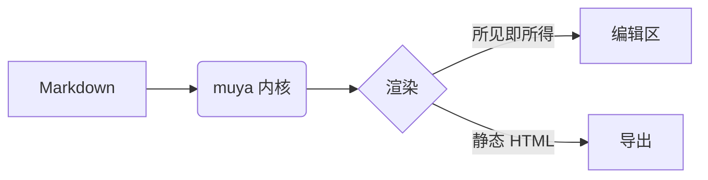

# Inkdown 功能演示

这是一份用于验证 Inkdown 各项能力的示例文档。用 `Ctrl+O` 打开本文件，
即可体验边写边渲染的实时排版效果。

## 一、文本格式

支持**加粗**、*斜体*、<u>下划线</u>、~~删除线~~、`行内代码` 与 ==高亮==。

行内数学公式：$E = mc^2$，以及质能方程展开 $E^2 = p^2c^2 + m^2c^4$。

## 二、列表

无序列表：

- 第一项
- 第二项
  - 嵌套项
- 第三项

有序列表：

1. 准备环境
2. 编写内容
3. 导出成果

任务列表（点击复选框可切换状态）：

- [x] 搭建项目骨架
- [x] 接入 muya 编辑器内核
- [x] 实现文件树与多标签
- [ ] 补充更多主题

## 三、代码块

```typescript
interface Document {
  path: string
  content: string
}

function wordCount(markdown: string): number {
  const cjk = (markdown.match(/[\u4e00-\u9fa5]/g) || []).length
  return cjk + (markdown.match(/[A-Za-z0-9_'-]+/g) || []).length
}
```

```python
def fib(n: int) -> int:
    a, b = 0, 1
    for _ in range(n):
        a, b = b, a + b
    return a
```

## 四、表格

| 功能 | 状态 | 说明 |
| --- | :---: | --- |
| 实时渲染 | ✅ | 光标处显示源码，离开即渲染 |
| 大纲 | ✅ | 点击可跳转到对应标题 |
| 专注模式 | ✅ | 淡化非当前段落 |
| 打字机模式 | ✅ | 光标行居中滚动 |
| 导出 | ✅ | HTML 与 PDF |

## 五、引用与分隔线

> 写作是把思考变成文字的过程。
>
> 多行引用同样支持，段落之间保持可读的间距。

---

## 六、数学公式块

$$
\int_{-\infty}^{\infty} e^{-x^2}\,dx = \sqrt{\pi}
$$

## 七、图表



## 八、脚注与链接

Inkdown 基于 marktext 的编辑器内核构建[^1]，并参考了 Typora 的交互设计。

[^1]: muya（`@muyajs/core`）是 marktext 抽离出的独立 Markdown 编辑器内核。

更多信息参见 [marktext 仓库](https://github.com/marktext/marktext)。
